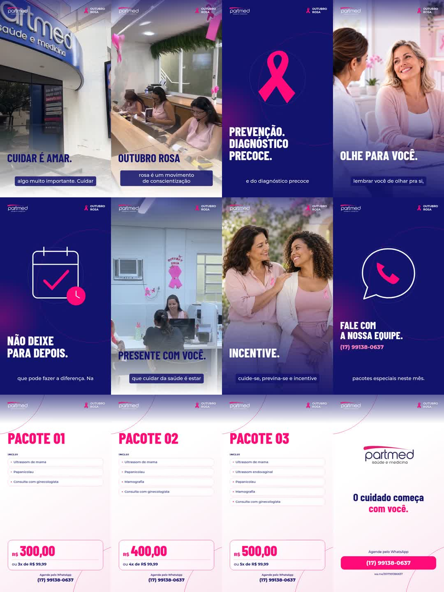

# Partmed • Outubro Rosa

Projeto Remotion institucional e comercial. Composição 1080×1920, 30 FPS.

## Assistir à prévia com áudio

[Baixar MP4 de revisão](https://github.com/bmktechai-git/criacao/raw/refs/heads/main/review/Partmed-Outubro-Rosa-PREVIA-v3.mp4) • [Tempos da locução e dos cards](review/tempos.md)

Prévia reduzida de 94 segundos, com áudio tratado integral, legendas, imagens ilustrativas e motion. Não é a exportação final aprovada.



## Abrir o Remotion no navegador

1. Abra **Code → Codespaces → Create codespace on main** neste repositório.
2. Aguarde a instalação das dependências.
3. Na aba **Ports / Portas**, abra a porta **3000** com **Open in Browser**. Mantenha a porta privada.
4. No Studio, selecione **Partmed-Outubro-Rosa** e pressione Play.

Se a porta não aparecer, rode no terminal:

```bash
cd partmed-outubro-rosa
npm run studio -- --port=3000
```

Codespaces depende da disponibilidade/cota da sua conta do GitHub. A configuração está preparada; nenhum Codespace foi criado automaticamente.

## Conteúdo

- Filmes originais e locução integral em `partmed-outubro-rosa/public/`.
- Animações, selo fixo de Outubro Rosa, três cards e encerramento com WhatsApp.
- Serviços e preços mantidos conforme o briefing.
- [Instruções e limitações da edição](partmed-outubro-rosa/README.md).

A edição é uma prévia para revisão, não uma exportação final aprovada. O arquivo recebido como sala de exame mostra o Setor de Exames e área de atendimento, sem confirmação visual de uma sala ginecológica privativa.
